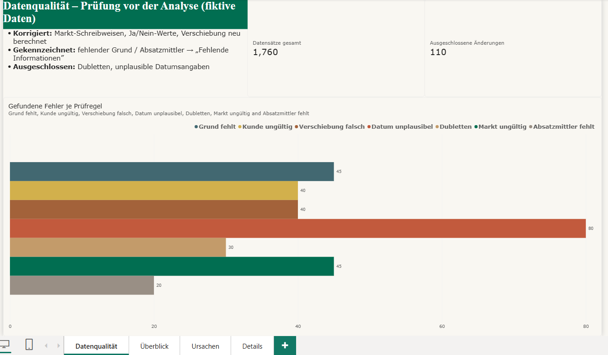
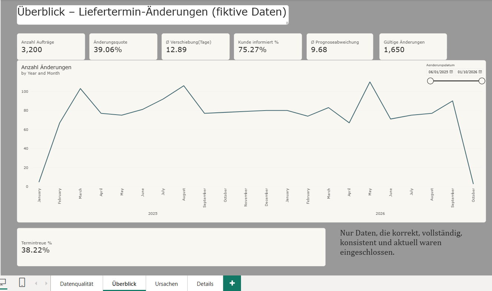
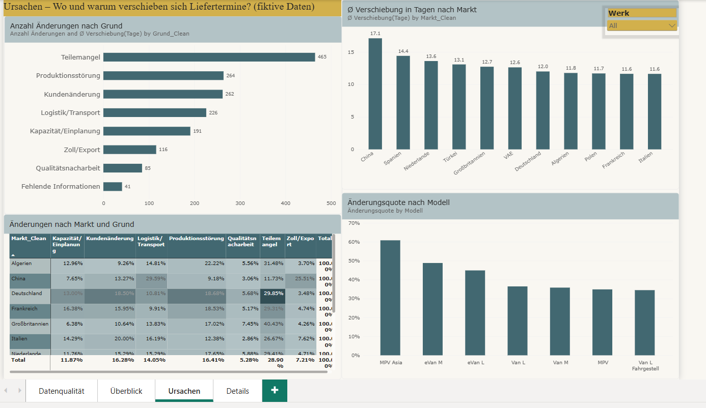
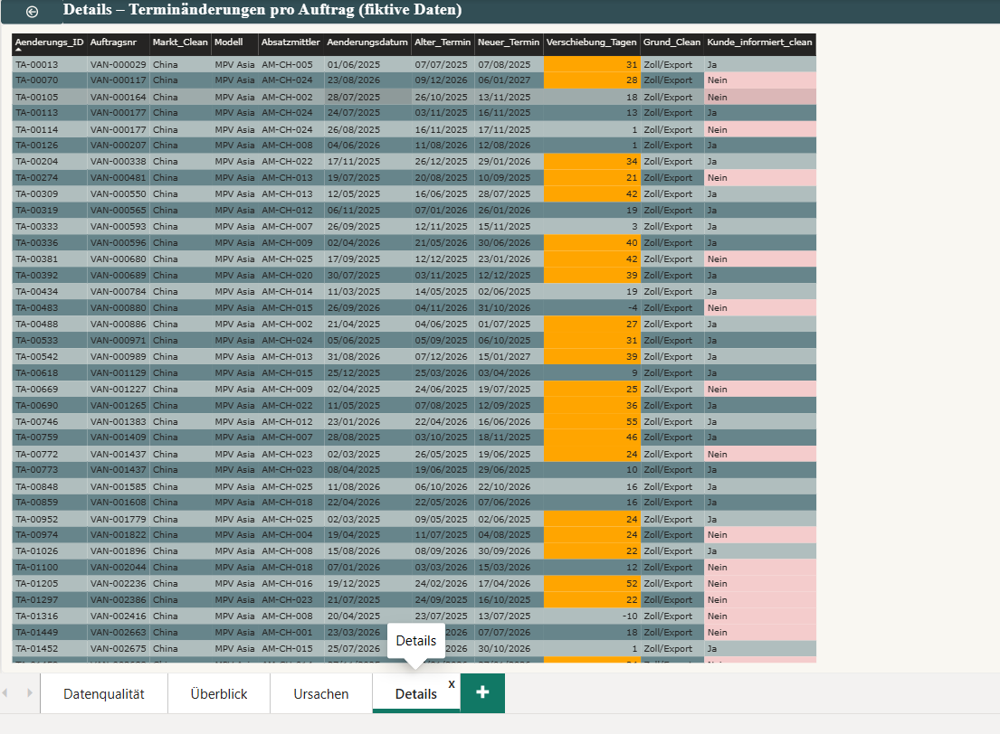

# Liefertermin-Änderungen – Datenqualität & Power-BI-Dashboard

**English summary:** A Power BI prototype analysing delivery-date changes in vehicle order management. Before any KPI is calculated, seven data quality rules (Power Query + DAX) check the raw data. Faulty records are flagged rather than deleted, so every exclusion stays traceable. All data is fictional and was generated with Python.

**Hinweis:** Alle Daten sind **fiktiv** und mit Python selbst generiert (`data/generate_data.py`). Produkt-, Werks- und Händlernamen sind erfunden. Es werden keine echten Unternehmens- oder Kundendaten verwendet.

---

## Fragestellung

Im Auftragsmanagement eines Fahrzeugherstellers ändern sich Liefertermine laufend, etwa durch Teilemangel, Produktionsstörungen, Kundenänderungen oder Logistik. Das Projekt beantwortet drei Fragen:

1. **Wie verlässlich sind die Daten?** Ein Teil der Änderungen wird manuell erfasst und ist entsprechend fehleranfällig.
2. **Wie stark und warum verschieben sich Liefertermine?** Ausgewertet nach Grund, Markt und Modell.
3. **Werden Kunden über Verschiebungen informiert?**

Der Grundsatz dabei: **erst die Datenqualität prüfen, dann die KPIs berechnen.**

## Datenmodell

| Tabelle | Inhalt | Zeilen |
|---|---|---|
| `Auftraege` | 1 Zeile pro Auftrag (Modell, Werk, Markt, Absatzmittler, Liefertermine, Status) | 3.200 |
| `Terminaenderungen` | 1 Zeile pro Liefertermin-Änderung (alter/neuer Termin, Grund, Kunde informiert, Erfassungsart) | 1.760 |
| `Stammliste_Land` | gültige Marktbezeichnungen (Referenzliste) | 11 |

Beziehung: `Auftraege[Auftragsnr]` **1 → \*** `Terminaenderungen[Auftragsnr]`

## Datenqualität: 7 Prüfregeln

| # | Prüfregel | Treffer | Umgang |
|---|---|---|---|
| 1 | Änderungsgrund fehlt | 45 | gekennzeichnet → „Fehlende Informationen“ |
| 2 | „Kunde informiert“ ungültig (z. B. `yes`, `j`, leer) | 40 | auf Ja / Nein / Unbekannt vereinheitlicht |
| 3 | Verschiebung ≠ Differenz neuer − alter Termin | 40 | Verschiebung neu berechnet |
| 4 | Datum unplausibel (nach Datenstand oder neuer Termin vor Änderungsdatum) | 80 | **ausgeschlossen** |
| 5 | Dubletten (gleiche Änderungs-ID) | 30 | **ausgeschlossen** (erste Zeile bleibt) |
| 6 | Markt nicht in Stammliste (z. B. `DE`, `France`, `CN`) | 45 | auf Stammliste gemappt |
| 7 | Absatzmittler fehlt | 20 | gekennzeichnet |

**Ergebnis:** 110 von 1.760 Änderungen werden aus der Analyse **ausgeschlossen, aber nicht gelöscht**. Über die Spalte `Gueltig_final` bleibt jede Zeile sichtbar und nachvollziehbar.

## Dashboard (4 Seiten)

| Seite | Inhalt |
|---|---|
| **Datenqualität** | Treffer je Prüfregel, ausgeschlossene Datensätze, Umgang mit Fehlern |
| **Überblick** | KPIs: Änderungsquote, Ø Verschiebung, Kunde informiert %, Termintreue %, Ø Prognoseabweichung; Verlauf über die Zeit |
| **Ursachen** | Änderungen nach Grund; Ø Verschiebung nach Markt; Änderungsquote nach Modell; Heatmap Markt × Grund |
| **Details** | Auftragsebene mit Drill-through und farblicher Markierung (nicht informierte Kunden, große Verschiebungen) |

 

## Ausgewählte Erkenntnisse (fiktive Daten)

- **Termintreue nur ca. 38 %:** Weniger als 4 von 10 ausgelieferten Aufträgen kommen innerhalb von ±2 Tagen des ursprünglich zugesagten Termins.
- **Teilemangel** ist mit Abstand der häufigste Änderungsgrund.
- **Ein Exportmarkt fällt auf:** längere Verschiebungen, mehr Zoll- und Logistikgründe und eine deutlich niedrigere Quote informierter Kunden.
- **E-Modelle** haben eine höhere Änderungsquote als die Verbrenner-Varianten.

## Technik

- **Power Query (M):** Typisierung, Prüfspalten, Merge mit der Stammliste, Bereinigung der Marktnamen, Index für die Dublettenerkennung
- **DAX:** KPI-Measures, Prüfregel-Measures, berechnete Spalten (`Ist_Dublette`, `Gueltig_final`), bedingte Formatierung
- **Python (pandas):** Generator für die fiktiven Daten inklusive gezielt eingebauter Erfassungsfehler

## Selbst ausprobieren

1. Repository herunterladen.
2. Die `.pbix`-Datei in Power BI Desktop öffnen.
3. Unter *Daten transformieren → Datenquelleneinstellungen* den Pfad auf `data/Liefertermin_Prototyp_Daten.xlsx` ändern und *Aktualisieren* klicken.

## Grenzen & nächste Schritte

- Die Daten sind synthetisch; reale Fehlerbilder sind vielfältiger.
- Mögliche Erweiterungen: automatische Benachrichtigung bei neuen Datenfehlern (Power Automate), inkrementelle Aktualisierung, eine Datumsdimension statt Auto-Date/Time.

---

**Autor:** Subhi Al-Sela · B.Sc. Wirtschaftsingenieurwesen, Masterstudent Wirtschaftsingenieurwesen (Universität Duisburg-Essen) · [LinkedIn](https://www.linkedin.com/in/subhi-al-sela-39b72a238/?isSelfProfile=true)
